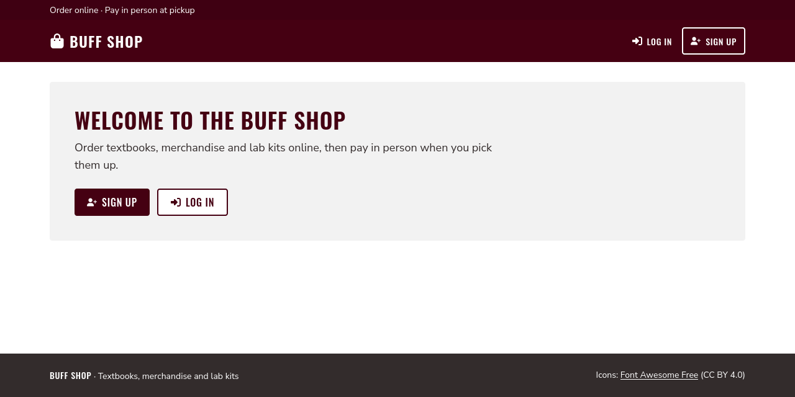
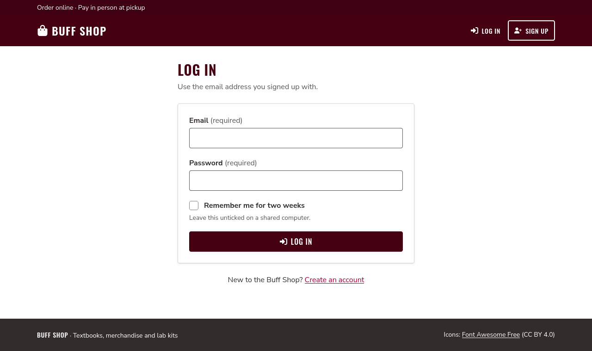
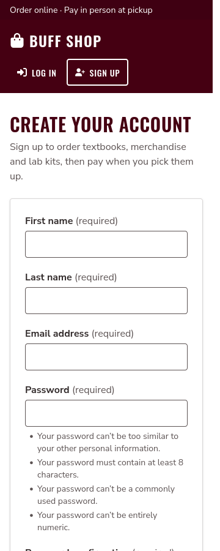

# Buff Shop

An online ordering site for a campus shop that sells textbooks, merchandise and lab kits. CIDM 4360 final project.

## What it's for

Right now the shop tracks stock in spreadsheets, and students can't order online. With Buff Shop:

- **Customers** browse the catalog, see whether items are in stock, and place an order. They pay in person when they pick it up. Each order gets a pickup code and a QR code.
- **Staff** use a dashboard to manage stock and orders, check pickup codes at handover, and see sales figures.



> **Status:** the app is being built in 18 phases (see [plans/buff-shop.md](plans/buff-shop.md)). **Phase 1 is done**: you can create an account, log in and log out. The catalog, cart, orders and staff dashboard come in later phases.

| Log in with your email | Works on a phone |
|---|---|
|  |  |

Built with Django, SQLite and Tailwind CSS.

## Preparation (one time)

1. Install **git** and **uv** (uv manages Python and the packages). To install uv, follow https://docs.astral.sh/uv/getting-started/installation/
2. Get the code and open its folder:
   ```bash
   git clone https://github.com/pj1163928/Buff-Shop.git
   cd Buff-Shop
   ```
3. Install everything:
   ```bash
   uv sync
   ```
4. Create the database:
   ```bash
   uv run python manage.py migrate
   ```
5. Optional: create an admin account for `/admin/`:
   ```bash
   uv run python manage.py createsuperuser
   ```

## Run the site

```bash
uv run python manage.py tailwind runserver
```

Open http://127.0.0.1:8000/ in your browser. Press `Ctrl+C` to stop.

- The first run downloads the Tailwind tool (about 100 MB), so it takes a few minutes.
- If you only want to look at the site, `uv run python manage.py runserver` also works. The built stylesheet is already included.
- On Windows, if Tailwind fails with **WinError 4551**, Windows Smart App Control is blocking the Tailwind tool. Use plain `runserver` instead.

## Test the application

**Automated tests**

```bash
uv run pytest          # all tests, with a coverage report
uv run ruff check .    # code style and common mistakes
```

Every test should pass and ruff should say `All checks passed!`.

**Try it in the browser**

1. Click **Sign up** and create an account. You're logged in and see a welcome message.
2. Log out, then log in again with your email. Capital letters in the email don't matter.
3. Try a wrong password. You see "The email or password is incorrect."
4. Try a weak password when signing up, such as `password123`. You're told why it isn't allowed.
5. Press **Tab** on any page. A "Skip to main content" link appears, and every button and field shows a clear outline.

## Project guide

- [prd/buff-shop.md](prd/buff-shop.md): full requirements
- [plans/buff-shop.md](plans/buff-shop.md): the build plan, phase by phase
- [docs/](docs/): notes on architecture, business rules, front end and testing
