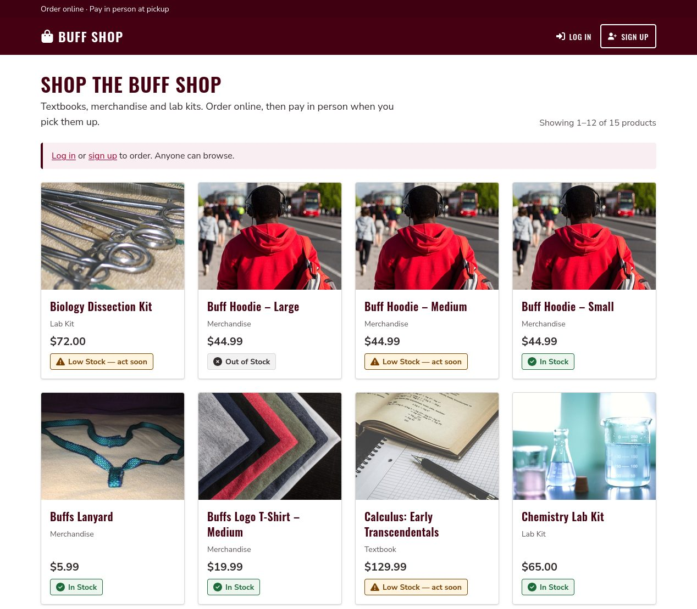
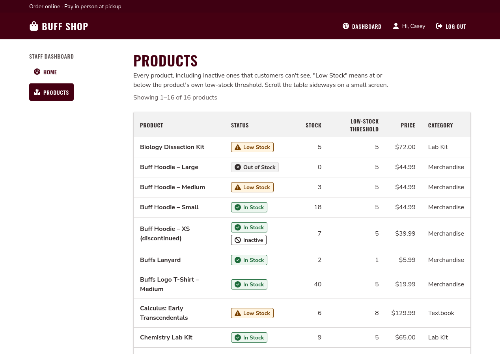

# Buff Shop

An online ordering site for a campus shop that sells textbooks, merchandise and lab kits. CIDM 4360 final project.

## What it's for

Right now the shop tracks stock in spreadsheets, and students can't order online. With Buff Shop:

- **Customers** browse the catalog, see whether items are in stock, and place an order. They pay in person when they pick it up. Each order gets a pickup code and a QR code.
- **Staff** use a dashboard to manage stock and orders, check pickup codes at handover, and see sales figures.



> **Status:** the app is being built in 18 phases (see [plans/buff-shop.md](plans/buff-shop.md)). **Phases 1–3 are done**: accounts (sign up, log in, log out), the product catalog with stock status, and the start of the staff dashboard (a list of every product with "Low Stock" and "Inactive" badges). Django's built-in `/admin/` is for the superuser only. The cart, orders and the rest of the dashboard come in later phases.

| Log in with your email | Works on a phone |
|---|---|
|  |  |



Built with Django, SQLite and Tailwind CSS.

## Preparation (one time)

1. Install **git** and **uv** (uv manages Python and the packages). To install uv, follow https://docs.astral.sh/uv/getting-started/installation/
2. Get the code and open its folder:
   ```bash
   git clone https://github.com/pj1163928/Buff-Shop.git
   cd Buff-Shop
   ```
3. Install everything:
   ```bash
   uv sync
   ```
4. Create the database:
   ```bash
   uv run python manage.py migrate
   ```
5. Load the demo data: the demo accounts below, 16 products and their photos:
   ```bash
   uv run python manage.py seed_demo
   ```
   It's safe to run again: it never duplicates anything or overwrites stock, and it never replaces a product photo that's already there. It only resets the demo staff and customer accounts to the passwords below.

## Demo sign-ins

`seed_demo` creates these accounts and prints them when it runs. **They're for development and the class demo only: the passwords are public.** The command refuses to run under production settings.

| Role | Email | Password | What they can do |
|---|---|---|---|
| Superuser (shop owner) | `owner@buffshop.test` | `Owner-Demo-Pass-26` | Everything staff can, plus Django's `/admin/` |
| Staff | `staff@buffshop.test` | `Staff-Demo-Pass-26` | The staff dashboard at `/dashboard/` |
| Customer | `alex@buffshop.test` | `Customer-Demo-Pass-26` | Browse and (in later phases) order |
| Customer | `sam@buffshop.test` | `Customer-Demo-Pass-26` | Same as Alex |
| Customer | `jordan@buffshop.test` | `Customer-Demo-Pass-26` | Same as Alex |

If you already had your own superuser with the owner's email, `seed_demo` leaves it alone and doesn't print its password.

## Run the site

```bash
uv run python manage.py tailwind runserver
```

Open http://127.0.0.1:8000/ in your browser. Press `Ctrl+C` to stop.

- The first run downloads the Tailwind tool (about 100 MB), so it takes a few minutes.
- If you only want to look at the site, `uv run python manage.py runserver` also works. The built stylesheet is already included.
- On Windows, if Tailwind fails with **WinError 4551**, Windows Smart App Control is blocking the Tailwind tool. Use plain `runserver` instead.

## Test the application

**Automated tests**

```bash
uv run pytest          # all tests, with a coverage report
uv run ruff check .    # code style and common mistakes
```

Every test should pass and ruff should say `All checks passed!`.

**Try it in the browser**

1. Click **Sign up** and create an account. You're logged in and see a welcome message.
2. Log out, then log in again with your email. Capital letters in the email don't matter.
3. Try a wrong password. You see "The email or password is incorrect."
4. Try a weak password when signing up, such as `password123`. You're told why it isn't allowed.
5. Press **Tab** on any page. A "Skip to main content" link appears, and every button and field shows a clear outline.
6. On the home page, every product shows a photo, its price and its stock status in words ("In Stock", "Low Stock — act soon" or "Out of Stock").
7. Log in as **staff** (see [Demo sign-ins](#demo-sign-ins)). A **Dashboard** link appears in the header. **Products** lists every product, including the inactive "Buff Hoodie – XS (discontinued)", which customers never see.
8. Log in as a **customer** and go to `/dashboard/`. You see "Access denied". At `/admin/`, staff and customers are both turned away; only the owner gets in.

## Image credits

The demo product photos are openly licensed (CC0 or CC BY 2.0) placeholders. Their authors, licenses and sources are listed in [demo/images/CREDITS.md](demo/images/CREDITS.md).

## Project guide

- [prd/buff-shop.md](prd/buff-shop.md): full requirements
- [plans/buff-shop.md](plans/buff-shop.md): the build plan, phase by phase
- [docs/](docs/): notes on architecture, business rules, front end and testing
